## Basic CI/CD 

1) Развернем 2 ВМ с установленной Ubuntu Server 24.04 LTS. 

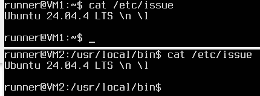

2) Установим на ВМ1 gitlab-runner.

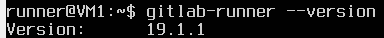

3) В файле .gitlab-ci.yml добавим этап запуска сборки через мейк файл из проекта SimpleBashUtils.
Файлы, полученные после сборки (артефакты), сохраним в произвольную директорию со сроком хранения 30 дней.

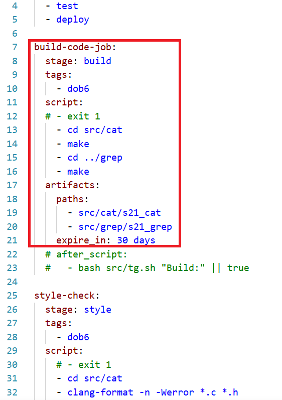

4) Напишем этап для CI, который запускает скрипт кодстайла (clang-format).

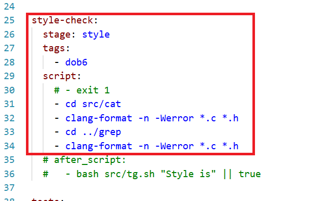

5) Напишем этап для CI, который запустит интеграционные тесты.

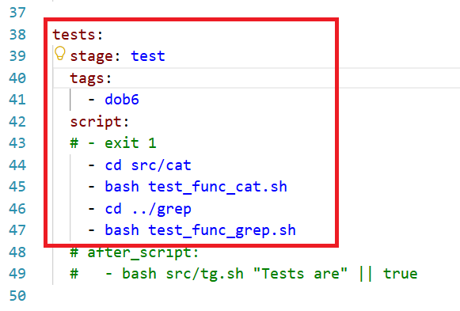

6) Напишем этап для CD, который «разворачивает» проект на другой виртуальной машине. 
Запустим этот этап вручную при условии, что все предыдущие этапы прошли успешно.

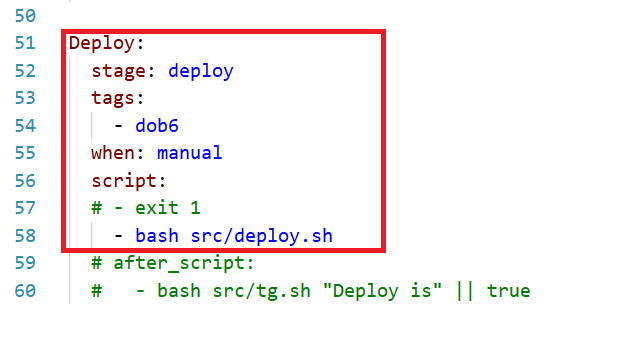

7) Сохраним дампы образов виртуальных машин (но не в git).

## Тестирование пайплайна

Запустим несколько вариантов тестов, чтобы проверить работу пайплайна.

1) Фиксируем отсутствие артефактов на production машине (ВМ2).

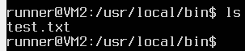

2) FAIL на этапе build.

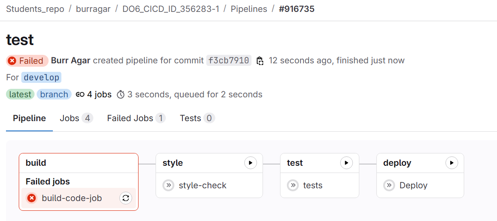

3) FAIL на этапе style.

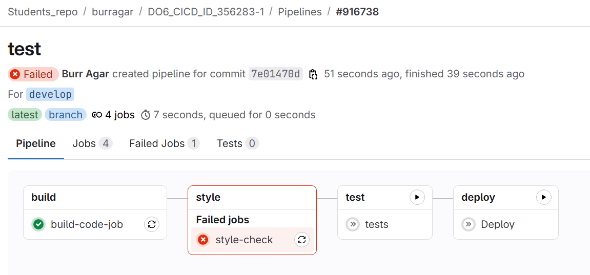

4) FAIL на этапе test.

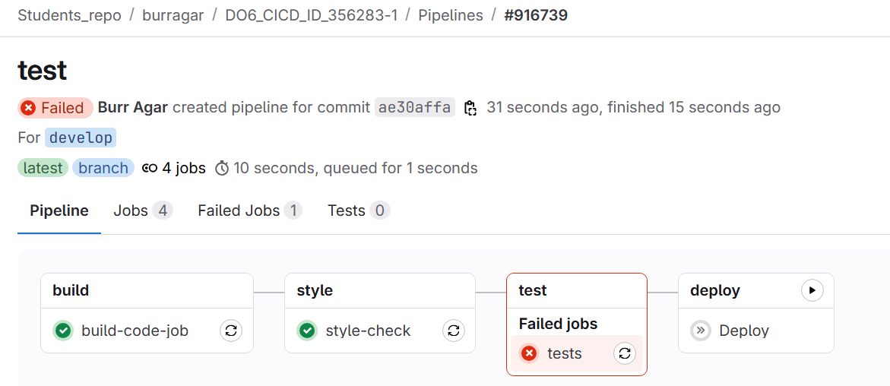

5) FAIL на этапе deploy (только после запуска вручную).

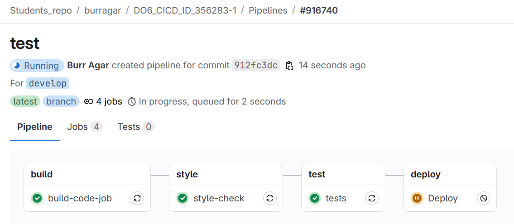

6) Успешный пайплайн.

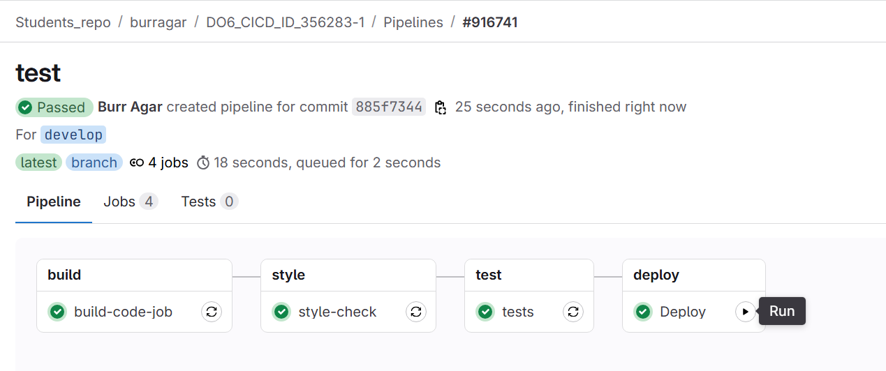

7) Фиксируем успешное создание готовых к работе приложений s21_cat и s21_grep на production машине (ВМ2).

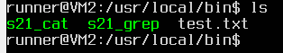